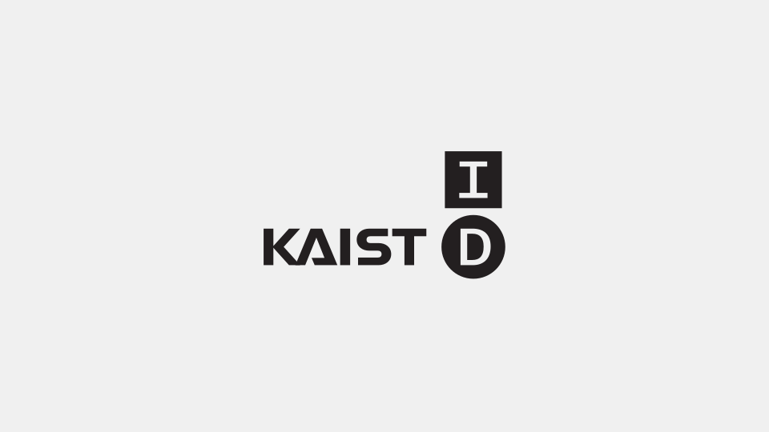
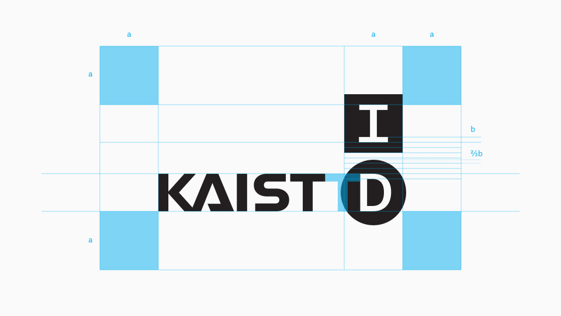
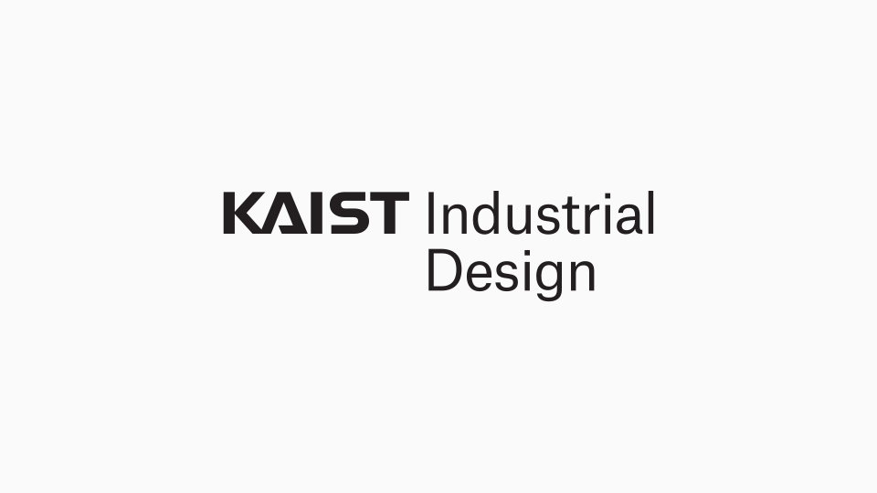
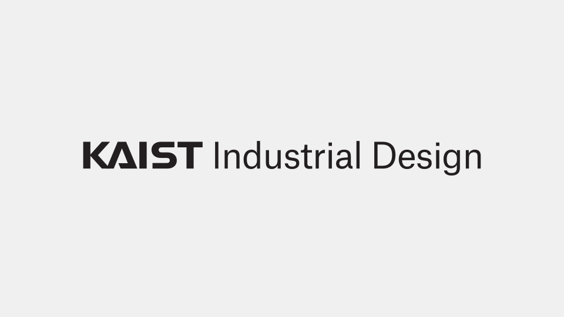
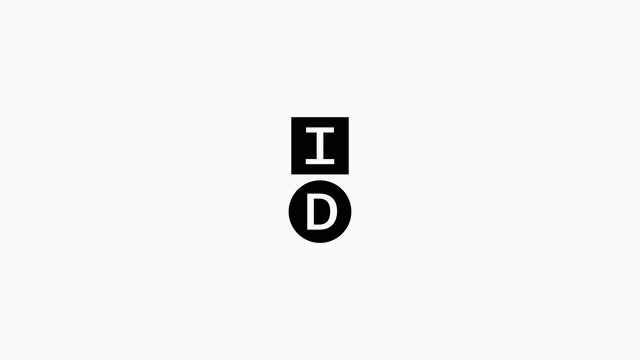
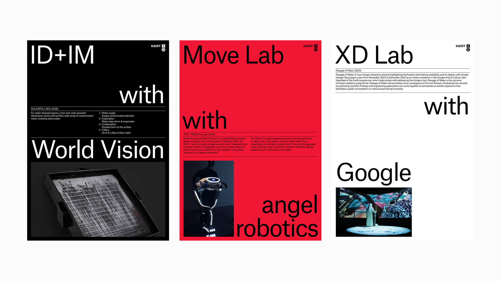
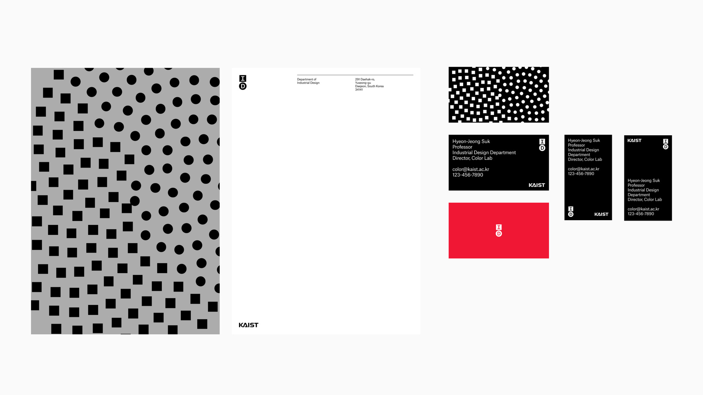
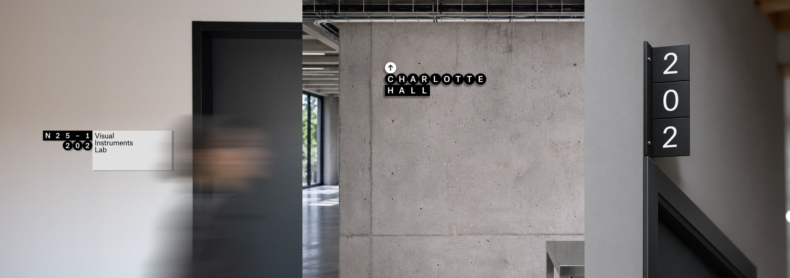

# KAIST ID Identity

KAIST 산업디자인학과의 새로운 로고는 학과의 이름인 I와 D를 원과 사각형에 담았습니다. 원과 사각형은 각각 산업디자인이 다루는 인간과 사회의 관계, 구조와 지식의 체계를 상징하며, 그 사이의 관계와 긴장을 표현합니다. 두 형태는 서로 구분되는 동시에 보는 방향에 따라 원과 사각형으로 보이는 하나의 입체로 연결되어, 서로 다른 관점과 접근이 만나 하나를 이루듯 학과의 다양한 생각과 활동을 담는 그릇이 됩니다.

The new identity for the KAIST Department of Industrial Design brings together the letters I and D with a circle and a square. The two shapes represent aspects of the discipline: relationships between people and society, and the structures and systems of knowledge through which design operates. Distinct in two dimensions, the shapes can also come together as a single form, appearing as a circle or a square depending on the point of view. The identity holds space for different perspectives and approaches, reflecting the range of ideas and activities that make up the department.

[다운로드 Download](assets/kaist-id-logo.ai?raw=true)

## 로고의 구조 Construction

KAIST 워드마크와 원 안의 D는 높이가 같습니다. 로고의 상하좌우에는 I를 담은 사각형의 한 변만큼 여백을 둡니다.  
The D inside the circle is the same height as the KAIST wordmark. Leave one I-square’s width of clear space on all four sides of the logo.

## 학과명 Department name

  
  

[다운로드 Download](assets/kaist-id-logo.ai?raw=true)

## 움직임 Motion

Industrial Design의 두 단어가 각각 첫 글자만 남기고 줄어들며 로고를 이룹니다. 영상의 오프닝이나 클로징 등에 활용할 수 있습니다.  
“Industrial” and “Design” draw back to their initials as the square and circle take shape. The animation can open or close a video.

**Smooth**

  
  

다운로드 Download  
[Smooth / White](assets/kaist-id-animation/kaist-id-smooth.mp4?raw=true) | [Smooth / Black](assets/kaist-id-animation/kaist-id-smooth-inverted.mp4?raw=true)

**Bouncy**

  
  

다운로드 Download  
[Bouncy / White](assets/kaist-id-animation/kaist-id-bouncy.mp4?raw=true) | [Bouncy / Black](assets/kaist-id-animation/kaist-id-bouncy-inverted.mp4?raw=true)

## 입체 In three dimensions

두 형태는 하나의 입체로 연결되어, 보는 방향에 따라 원이나 사각형으로 보입니다.  
The two shapes come together as a single form, appearing as a circle or a square depending on the point of view.

[전체 영상 보기 Watch the full presentation (24 s)](assets/3d/3d-presentation.mov)

## 적용 예시 Application samples

